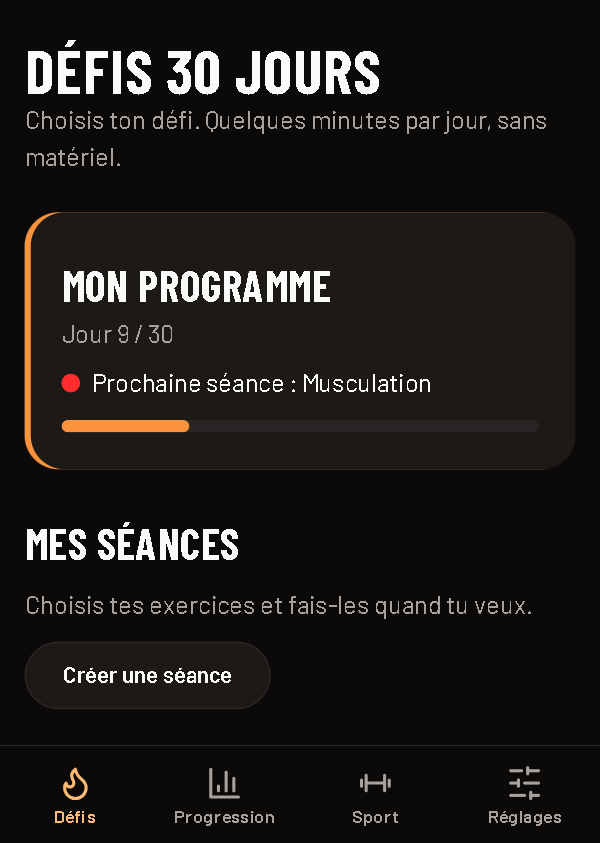
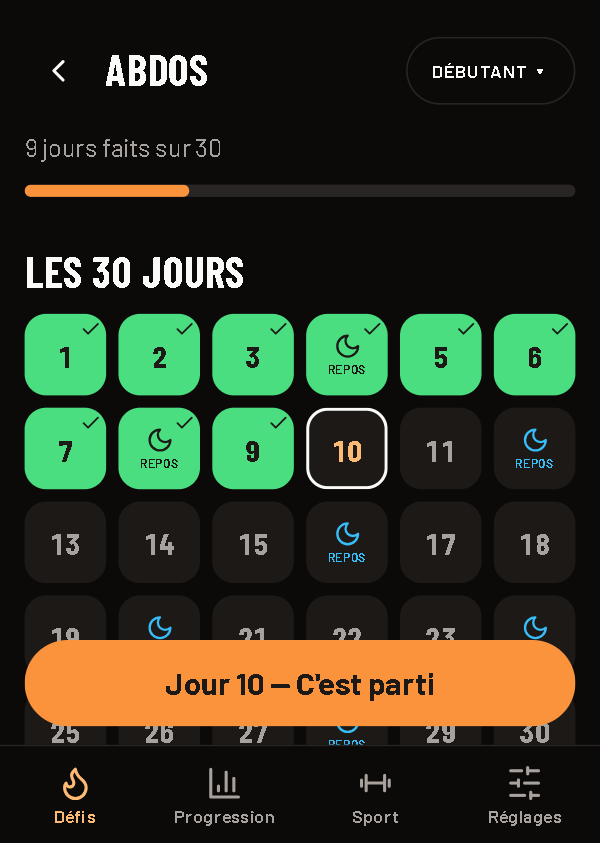
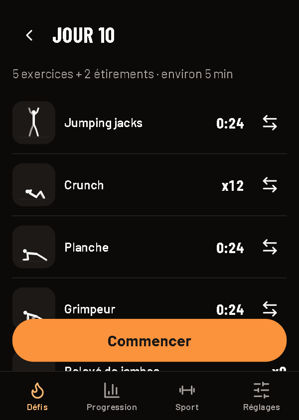
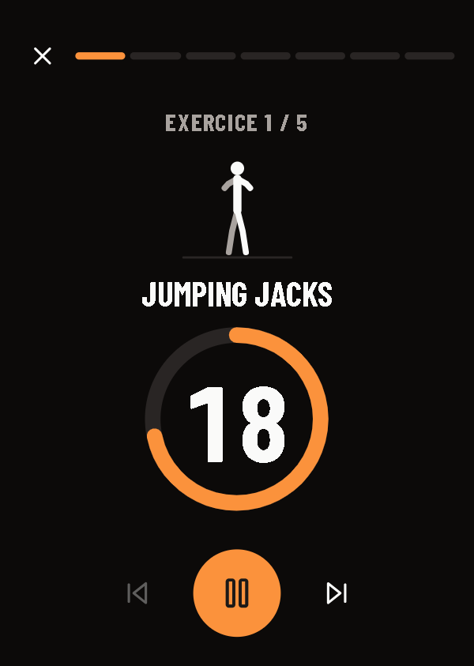
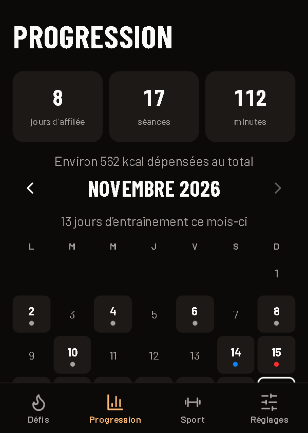
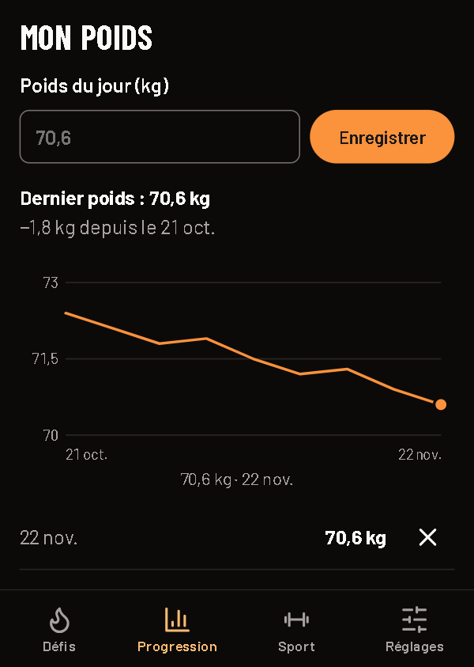
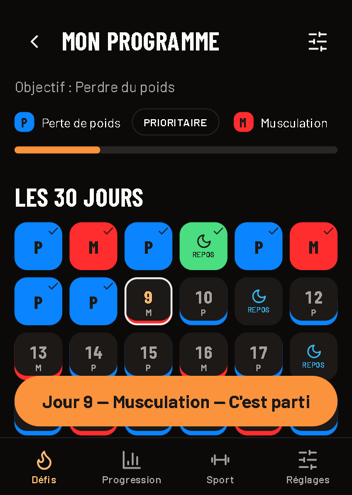
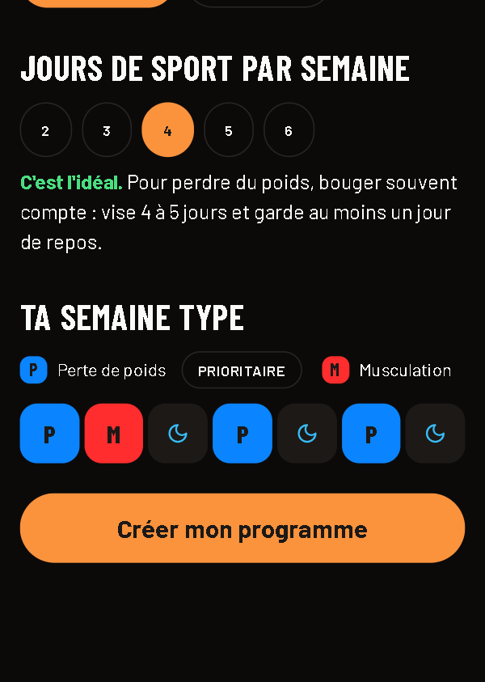
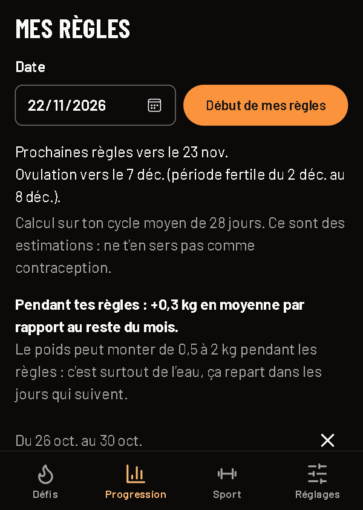
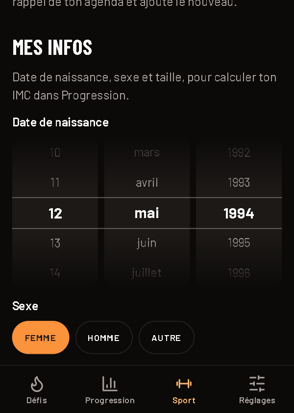

# 🔥 Renascor — Défis sportifs de 30 jours

**Renascor** est une application web progressive (PWA) pour se mettre au sport chez soi, sans matériel ou avec le tien (haltères, corde à sauter, tapis de course, vélo d'appartement). Choisis un défi de 30 jours ou combine-en plusieurs dans un programme fait pour ton objectif, suis la séance du jour guidée par la minuterie, et regarde tes jours se cocher un à un. Quelques minutes par jour suffisent. Disponible en 9 langues. Sans compte, sans publicité, sans abonnement : tes données restent sur ton téléphone.

🔗 **Accéder à l'app** : [https://renascor.vercel.app](https://renascor.vercel.app)

---

## 👀 Aperçu de l'app

<table>
  <tr>
    <td align="center"> <b>Les défis</b></td>
    <td align="center"> <b>Les 30 jours</b></td>
    <td align="center"> <b>La séance du jour</b></td>
  </tr>
  <tr>
    <td align="center"> <b>La minuterie</b></td>
    <td align="center"> <b>La progression</b></td>
    <td align="center"> <b>Le poids</b></td>
  </tr>
  <tr>
    <td align="center"> <b>Mon programme</b></td>
    <td align="center"> <b>Créer son programme</b></td>
    <td align="center"> <b>Mes règles</b></td>
  </tr>
  <tr>
    <td align="center"> <b>Date de naissance</b></td>
    <td></td>
    <td></td>
  </tr>
</table>

*Captures réalisées avec des données d'exemple.*

---

## 📱 Les 4 onglets

| Onglet | Description |
|---|---|
| 🔥 **Défis** | **Mon programme** en haut (plusieurs défis dans un même planning en couleurs), tes séances perso, puis les 9 défis seuls (Perte de poids, Musculation, Prise de masse, Abdos, Fessiers, Corps entier, Jambes, Bras, Dos), chacun en 3 niveaux. Grille des 30 jours avec les jours faits, les jours de repos et le jour à faire. |
| 📊 **Progression** | Jours d'affilée, nombre de séances, minutes et calories estimées, calendrier du mois avec un point de couleur par défi (touche un jour pour voir ses séances, son poids et le total de la semaine, ou supprimer une séance), suivi du poids avec sa courbe et ton IMC, et pour les femmes la carte **Mes règles** (début et fin, prochaines règles, ovulation, effet sur le poids). |
| 🏋️ **Sport** | Ton objectif (modifiable à tout moment), ton matériel, la durée du repos, la voix du coach (femme, homme ou voix du téléphone) et les bips pendant la séance, le rappel quotidien dans ton agenda et tes infos (date de naissance choisie en faisant défiler jour, mois, année ; sexe ; taille). |
| ⚙️ **Réglages** | Les réglages de l'app : langue, thème (auto, clair ou sombre), style complet de l'app (Énergique, Nuit OLED, Bauhaus, Bien-être lavande, Miami : couleurs, police et formes), sauvegarde et restauration de tes données, numéro de version tout en bas. |

---

## ✨ Fonctionnalités principales

- 🌍 **9 langues** : français, anglais, allemand, espagnol, portugais, italien, néerlandais, polonais, turc (choisie au premier lancement, modifiable dans Réglages)
- 🏋️ **9 défis de 30 jours** : Perte de poids, Musculation, Prise de masse, Abdos, Fessiers, Corps entier, Jambes, Bras, Dos, chacun en niveau débutant, intermédiaire ou avancé
- 🗓️ **Mon programme** : combine 2 ou 3 défis ; l'appli construit un planning de 30 jours d'après ton objectif et donne le plus de jours au défi qui compte le plus pour toi. Chaque défi a sa couleur et son initiale sur le calendrier
- 📆 **De 2 à 6 jours de sport par semaine** au choix : l'appli te dit si c'est peu, idéal ou beaucoup pour ton objectif, et pourquoi
- 🏠 **Ton matériel compte** : avec des haltères, une corde à sauter, un tapis de course ou un vélo d'appartement, les exercices s'adaptent (et tu peux toujours revenir à la version sans matériel)
- ✍️ **Mes séances** : crée ta propre séance en choisissant tes exercices, ton ordre et ton niveau
- 🎯 **Objectif modifiable** à tout moment : le défi prioritaire et la suite du planning s'adaptent, les jours déjà faits restent
- 📈 **Difficulté qui monte en douceur** jour après jour, avec un jour de repos tous les 4 jours
- 🔄 **Changer de niveau sans perdre ses jours** : tu gardes ta progression
- ⏱️ **Séance guidée** : décompte « Prêt ? », minuterie ou compteur de répétitions, repos avec l'exercice suivant, pause, précédent, suivant
- ➕ **+20 s de repos** quand tu en as besoin, et durée du repos réglable
- 🔁 **Remplacer un exercice** par une variante plus facile ou plus dure
- 🧘 **Étirements** à la fin de chaque séance
- 🙂 **« C'était comment ? »** après la séance : la suite s'adapte si c'était trop facile ou trop dur
- 🔊 **Voix et bips** pour suivre la séance sans regarder l'écran (activables dans Réglages)
- 💡 **L'écran reste allumé** pendant la séance
- ▶️ **Reprendre une séance coupée** (appel, appli fermée) là où tu t'étais arrêté
- 📅 **Rappel quotidien** ajouté à l'agenda de ton téléphone, à l'heure de ton choix, avec le lien pour ouvrir l'app
- 📸 **Partage ta réussite** : une image « Jour 12/30 » avec tes stats, prête pour WhatsApp, Instagram ou TikTok
- 🗓️ **Calendrier et série** de jours d'affilée pour garder la motivation
- ⚖️ **Suivi du poids et IMC** : note ton poids quand tu veux, regarde ta courbe évoluer et ton IMC se mettre à jour
- 🌗 **Thème clair ou sombre** au choix, ou automatique comme ton téléphone
- 💾 **Sauvegarde et restauration** des données dans un fichier
- 🎬 **Écran de démarrage animé** aux couleurs du logo, à chaque ouverture (un toucher pour le passer)
- ✈️ **Fonctionne hors connexion** une fois installée

---

## 🗓️ Historique des versions

| Version | Date | Nouveautés |
|---|---|---|
| 1.13.3 | 22 nov. 2026 | Captures refaites (dont la date de naissance en colonnes) ; texte « Mes infos » mis à jour |
| 1.13.2 | 22 nov. 2026 | Les téléphones rechargent les voix corrigées au lieu de garder les anciennes en mémoire |
| 1.13.1 | 22 nov. 2026 | Voix du coach corrigées : plus de sons en trop, et les noms d'exercices anglais (Jumping jacks, Squat, Plank…) prononcés comme dans chaque langue |
| **1.13** | 22 nov. 2026 | Voix du coach enregistrées, plus naturelles (femme ou homme, 9 langues, marchent hors connexion après la 1re écoute) ; 5 styles complets au choix ; date de naissance en colonnes qui défilent |
| 1.12 | 22 nov. 2026 | Touche un jour du calendrier : séances (durée, calories, ressenti), poids, règles et total de la semaine, avec suppression d'une séance ; jours de règles marqués dans le calendrier ; calories calculées selon ton poids ; note « ce sont des estimations » ; bleu et rouge vifs pour le programme ; jour actuel entouré en noir ou blanc |
| 1.11 | 22 nov. 2026 | Date de naissance au lieu de l'âge ; carte **Mes règles** pour les femmes : début et fin, prochaines règles et ovulation prévues dès la 1re date (28 jours puis ta moyenne), effet sur le poids |
| 1.10 | 18 nov. 2026 | Nouvel onglet **Sport** (objectif, matériel, séance, rappel, mes infos) ; **Réglages** ne garde que les réglages de l'app |
| **1.9** | 18 nov. 2026 | Écran de démarrage animé : le coureur du logo arrive en courant, les lettres de RENASCOR apparaissent une par une (on peut le passer d'un toucher) |
| 1.8.1 | 18 nov. 2026 | Nouveau logo de l'app (icône sur l'écran d'accueil et dans le navigateur) |
| **1.8** | 18 nov. 2026 | Objectif Prise de masse et son défi, question sur ton matériel (6 exercices avec haltères, corde, tapis ou vélo), 2 à 6 jours de sport par semaine avec un conseil selon ton objectif |
| 1.7.1 | 18 nov. 2026 | Rappel : retour à l'agenda à la place de la notification (rien n'est envoyé sur internet), rappel chaque jour sans fin, avec le lien de l'app |
| **1.7** | 18 nov. 2026 | Mes séances (crée ta propre séance), défis Jambes, Bras et Dos, vraie notification de rappel, image de réussite à partager |
| **1.6.2** | 18 nov. 2026 | Nouvelle adresse : renascor.vercel.app (l’ancienne adresse est fermée) |
| **1.6** | 18 nov. 2026 | L’appli s’appelle maintenant **Renascor** |
| **1.5.1** | 14 nov. 2026 | Bloc « Mes infos » dans Réglages pour changer âge, sexe et taille |
| **1.5** | 14 nov. 2026 | Choix de la langue au premier lancement, questionnaire « Et toi ? » (âge, sexe, taille, poids), IMC dans Progression |
| **1.4.1** | 14 nov. 2026 | Corrections : « Arrêter le programme » revient bien aux défis, meilleure lecture par les lecteurs d'écran |
| **1.4** | 14 nov. 2026 | Mon programme (plusieurs défis dans un planning selon ton objectif, code couleur), défis Perte de poids et Musculation, 5 nouveaux exercices, objectif modifiable |
| **1.3** | 14 nov. 2026 | Suivi du poids avec courbe, choix du thème clair ou sombre |
| 1.2.1 | 14 nov. 2026 | Démo de la planche corrigée (avant-bras posés vers l'avant) |
| **1.2** | 14 nov. 2026 | Nouvelles démos animées pour les 22 exercices |
| **1.1** | 14 nov. 2026 | 9 langues (la voix parle aussi la langue choisie), numéro de version dans Réglages |
| **1.0** | 14 nov. 2026 | Première version : 3 défis en 3 niveaux, séance guidée, étirements, variantes, ressenti, rappel quotidien, sauvegarde |

Le numéro de version s'affiche tout en bas de l'onglet **Réglages**.

---

## 📲 Installation sur mobile

### 🍏 iPhone (Safari)

1. Ouvre [https://renascor.vercel.app](https://renascor.vercel.app) dans **Safari**
2. Appuie sur l'icône **Partage** (le carré avec une flèche vers le haut) 🔗
3. Sélectionne **Sur l'écran d'accueil** ➕
4. Confirme en appuyant sur **Ajouter**

L'application apparaît alors comme une app native sur ton écran d'accueil. 🎉

### 🤖 Android (Chrome)

1. Ouvre [https://renascor.vercel.app](https://renascor.vercel.app) dans **Chrome**
2. Appuie sur le menu **⋮** (les 3 points en haut à droite)
3. Sélectionne **Ajouter à l'écran d'accueil** (ou **Installer l'application**)
4. Confirme l'ajout

L'application s'installe comme une app classique, avec son icône dédiée. 🎉

🔊 Pour entendre la voix et les bips, monte le son du téléphone et, sur iPhone, désactive le mode silencieux.

💾 Pense à faire une sauvegarde de temps en temps (onglet **Réglages**, en bas) : tes données sont perdues si tu désinstalles l'app.
